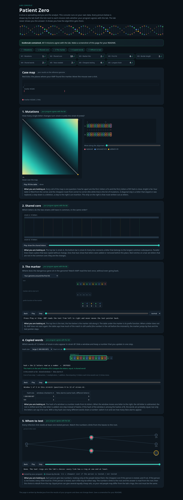

# Assignment 4. Patient Zero

Student ID: [write your Moodle ID]
Name: [your name]
Group: [your group]

This project compares two DNA strains, searches a genome for a marker, and finds which people to test in an infection tree. I used Java 17+.

## Program output

These are the results for **examples/tiny**, not my personal variant. I need to replace them with my own nine lines after running `MakeVariant` with my exact Moodle ID.

    Mutations: 1
    Shared core: 13
    Marker hits: 2
    First hit: 0
    Border length: 2
    Shared words: 2
    Tests needed: 2
    Cheapest testing: 6
    Longest chain: 4

Lab console screenshot (also for the tiny example; replace with the screenshot of my own data before submitting):



## Questions

### Mission 1

d[i][j] means the minimum changes to turn the first i letters of A into the first j letters of B. I take the smallest answer from deleting, inserting or replacing the last letter. If the two last letters are equal, the diagonal step costs 0 instead of 1.

### Mission 2

A subsequence keeps the order of the letters, but it can skip some letters. A substring must be one continuous part of the string. Shared core can be bigger than the matches at the same indexes because the letters can match at different positions after an insertion or deletion.

### Mission 3

The prefix function shows how much of the beginning of the pattern is also at the end of each part of that pattern. KMP uses it after a mismatch, so it does not need to move the text pointer back. In the tiny example the marker is `ACGAC` and its border length is 2: `AC` is both its prefix and suffix. The border for my own marker must be taken from my output.

### Mission 4

Two different words can have the same hash, so I compare the actual letters when the hashes match. A lot of collisions make the algorithm slower because it needs more comparisons. With few collisions, the rolling hash lets us check the next window quickly.

### Mission 5

For each person I store two costs: when this person is tested and when this person is not tested. If they are tested, each child can use its cheaper state. If they are not tested, every child must be tested. Choosing the person with the most links first is not always cheapest because that person can have a high test cost while several neighbours are cheap.

## AI use

I used ChatGPT to help write and check the Java methods and to explain the algorithms and README questions. I will review and adjust the code and explanations myself before submitting. I did not use external code sources.

## Timing (Mission 7)

Measurements in milliseconds (average of 3 runs) from `java -cp out Bench`, measured with Java 21 on the test environment. These can be different on my computer.

| Test | Size | Time |
|---|---|---|
| Naive search | 20 000 / 40 000 / 80 000 | 30.6 / 74.8 / 154.8 ms |
| KMP | 20 000 / 40 000 / 80 000 | 3.2 / 1.0 / 0.5 ms |
| Edit distance | 500 / 1000 / 2000 / 4000 | 6.6 / 9.2 / 24.9 / 120.4 ms |

The naive search becomes slower quite fast when the text gets longer, while KMP only scans it once. The KMP times are very short and can vary because Java optimizes code while it is running. Edit distance uses a two-dimensional table, so doubling both string lengths means roughly four times as many cells.

## Complexity

Here n and m are the lengths of the two strings (or the text and pattern), k is the word length and v is the number of people.

| Algorithm | Time | Space | Why |
|---|---|---|---|
| Edit distance | O(n*m) | O(n*m) | A table with n*m cells |
| LCS | O(n*m) | O(n*m) | A table with n*m cells |
| Prefix function and KMP | O(n+m) | O(m+h) | The text is scanned once, and h hits are saved |
| Rabin-Karp (shared words) | Average O(n+m+k), worst O(n*m*k) | O(m) | Hashes update in O(1), but collisions need comparisons |
| Tree DP and longest chain | O(v) | O(v) | Each person and link is visited a constant number of times |

## Run the project

```bash
java tools/MakeVariant.java YOUR_STUDENT_ID data
javac -encoding UTF-8 -d out src/*.java
java -cp out Main
java tools/Check.java
java -cp out Bench
```

Open `output/outbreak.html` in a browser. Save a new screenshot as `output/outbreak.png`.

## Before submitting

- [ ] Replace the demo data with the four files generated from my exact Moodle student ID.
- [ ] Fill in my ID, name, group and nine personal output values above.
- [ ] Update the marker border explanation and screenshot for my personal data.
- [ ] Run `java tools/Check.java` and make sure all three examples pass.
- [ ] Review the code and the explanations so I can answer the Moodle defense quiz.
- [ ] Push the main branch with the source code, `data` files and the screenshot to a public GitHub repository.
- [ ] Submit the GitHub link in Moodle before the deadline.
